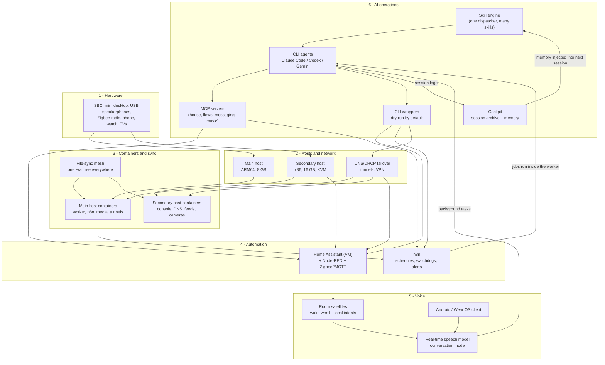

# Skippy

Architecture notes for a self-hosted home automation and AI operations platform, run by one engineer on two small servers.

> **This repository is documentation, not an installable product.** Skippy is tied to specific hardware,
> accounts and a single household, so its configuration is not published. What is published here is the
> design: the layers, how each one depends on the others, the decisions behind them and the failures that
> shaped them. The self-contained pieces that *can* be reused live in their own repositories, linked below.

## What it is

Skippy is the name of the whole system and of the AI persona that talks to the house. It started as a Home
Assistant install and grew into six layers:

1. **Hardware**: an ARM single-board computer, a small x86 desktop, USB speakerphones used as voice satellites,
   a Zigbee radio, phones, a watch and TVs.
2. **Hosts and network**: two Linux hosts with hardware watchdogs, home DNS/DHCP with automatic failover,
   outbound-only tunnels for remote access, a VPN for everything else.
3. **Containers and sync**: about 80 containers split across the two hosts, plus a file-sync mesh that makes
   one working tree (`~/ai`) identical on the servers and the workstation.
4. **Automation**: Home Assistant (as a VM), Node-RED and Zigbee2MQTT for the house; n8n (65 active
   workflows) for every scheduled job, watchdog and alert.
5. **Voice**: two always-on rooms with a custom wake word, local intents first, a real-time speech model for
   conversation, and a native Android client for the phone and watch.
6. **AI operations**: CLI coding agents (Claude Code, Codex, Gemini) driven by a single skill engine, MCP
   servers for the house and services, CLI wrappers that make writes dry-run by default, and a session
   archive that feeds memory back into the next session.

Each layer has its own page: what it is, what it depends on, what depends on it, the decisions and the traps.

| Layer | Page |
|---|---|
| 1. Hardware | [docs/layers/01-hardware.md](docs/layers/01-hardware.md) |
| 2. Hosts and network | [docs/layers/02-hosts-and-network.md](docs/layers/02-hosts-and-network.md) |
| 3. Containers and sync | [docs/layers/03-containers-and-sync.md](docs/layers/03-containers-and-sync.md) |
| 4. Automation | [docs/layers/04-automation.md](docs/layers/04-automation.md) |
| 5. Voice | [docs/layers/05-voice.md](docs/layers/05-voice.md) |
| 6. AI operations | [docs/layers/06-ai-operations.md](docs/layers/06-ai-operations.md) |

## Reusable pieces

These started as parts of Skippy and were extracted into standalone, documented repositories.

| Repository | Layer | What it solves |
|---|---|---|
| [cockpit](https://github.com/cascodigital/cockpit) | AI operations | Collects Claude Code, Codex and Gemini CLI session logs from several machines, indexes them for hybrid search, writes a nightly audit and distills memory files that are injected into the next session. |
| [whatsapp-mcp-server](https://github.com/cascodigital/whatsapp-mcp-server) | AI operations | Local WhatsApp message collector plus an MCP server, so agents can search and send messages without a cloud component. |
| [rolo](https://github.com/cascodigital/rolo) | AI operations | Turns a listening history into a taste profile and a deterministic validator that checks every claim an AI makes while building a playlist. |
| [kitchen-cast](https://github.com/cascodigital/kitchen-cast) | Automation | Home Assistant + Chromecast build: a kitchen TV that switches from photo frame to album art and a recipe overlay when music starts, with an AI worker building the playlist. |
| [skippy-tv](https://github.com/cascodigital/skippy-tv) | Automation / UI | Android TV home screen with live Home Assistant and Plex cards, a low-latency camera view and light controls. |
| [subtitle-auto-translator](https://github.com/cascodigital/subtitle-auto-translator) | Containers | Nightly batch job that extracts and translates subtitles for a media library, with a self-hosted fallback translator. One of the jobs the absence-of-signal watchdog tracks. |
| [hardmob-monitor](https://github.com/cascodigital/hardmob-monitor) | Containers | Small two-container service that turns a forum with no RSS into a token-protected feed. |
| [aurora-sweep-watchface](https://github.com/cascodigital/aurora-sweep-watchface) | Hardware / UI | Wear OS watch face tied to real sun, weather and season; the same watch runs the voice client tile. |

## Engineering highlights

- **Alerts on silence, not only on errors.** A deadman job checks that things which should have happened did
  happen (backup finished, nightly job ran, a watchdog rewrote its state file). A weekly "still alive" push
  covers the deadman itself. See [docs/case-studies/03-backup-deadman.md](docs/case-studies/03-backup-deadman.md).
- **"Running" is not "working".** A container reported `Up` for four days while its process was being killed
  by the OOM killer in a loop; a voice satellite had an open socket and a live microphone for 19 hours without
  hearing a single wake word. Both now have watchdogs that measure the output, not the process.
  See [case study 1](docs/case-studies/01-up-but-crash-looping.md) and [case study 4](docs/case-studies/04-deaf-satellite.md).
- **Measure before blaming.** A 68-second delay to start music was traced, with thread stack samples, to a stale
  IPv6 prefix the ISP router kept advertising. Fixed at the source: 6 seconds.
  See [case study 2](docs/case-studies/02-stale-ipv6-prefix.md).
- **Writes are dry-run by default.** Every CLI wrapper that changes state (Home Assistant, Node-RED, n8n, DNS)
  shows the diff first, and with `--apply` takes a backup, writes, re-reads, validates and prints the rollback
  command.
- **Failover that was proven by a real outage.** When the DNS/DHCP host went down, the watchdog on the other host
  declared it dead after 60 s and had emergency DHCP serving 17 clients 3 s later. Nobody had staged the test.
- **Every scheduled job reports through one error path.** A lint over all n8n workflows checks that each one has
  the global error workflow and that every SSH step is followed by a check of its exit code or output marker.
  Zero findings is the expected result; anything else is a regression.

The rules behind these are collected in [docs/engineering-principles.md](docs/engineering-principles.md).

## Case studies

| # | Story | Lesson |
|---|---|---|
| 1 | [Up for four days, crashing all along](docs/case-studies/01-up-but-crash-looping.md) | Watch the output a service produces, not its container state. |
| 2 | [68 seconds to press play](docs/case-studies/02-stale-ipv6-prefix.md) | Sample the stuck threads before guessing; fix the cause, not each host. |
| 3 | [Five days without a backup](docs/case-studies/03-backup-deadman.md) | Alert on the absence of a success signal, over two independent channels. |
| 4 | [Nineteen hours deaf](docs/case-studies/04-deaf-satellite.md) | A healthy socket proves nothing about whether the thing is listening. |

## Author

Built and operated by André, a systems engineer working in IT since 2012 and founder of the managed services
company Casco Digital. More work at [github.com/cascodigital](https://github.com/cascodigital).

Dates in these documents are taken from the operating notes of the live system. Hostnames, addresses,
identifiers and credentials are deliberately left out.
