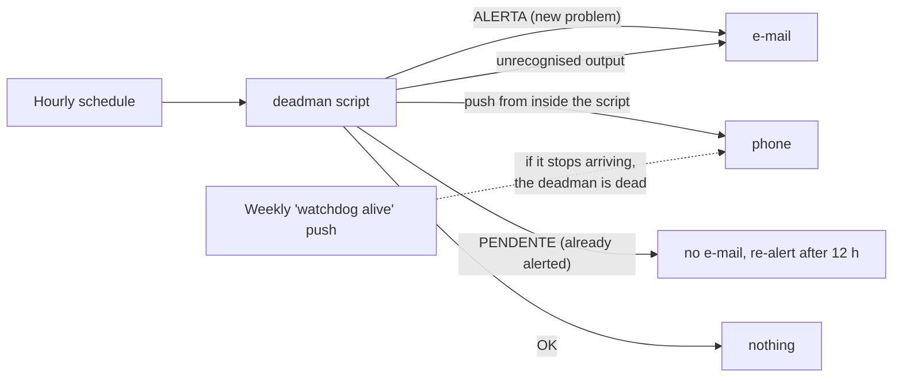

# Case study 3: Five days without a backup

**Layer:** hosts, automation. **Date:** September 2026.

## What happened

The laptop backs up to an external disk with restic, triggered hourly by a systemd timer until the day's backup
succeeds. An alert e-mail arrived: "4 days without backup, external disk not connected."

The disk was not the cause. Five days earlier a run had died midway (suspend or the disk pulled out) and left a stale
exclusive lock in the repository. From then on every run failed at `restic forget --prune`, which ran before
`restic backup`, so the backup never started. On one of those days the disk was mounted with 354 GB free and the run
still failed. The disconnected disk came later and masked the older cause.

The alert path had its own failure: on two of those days the e-mail never left, with `Name or service not known`.
The script runs early at boot, before the network is up, so the most urgent alert was the one that got lost.

## Fix

- `restic unlock` (the lock's PID no longer existed), then a manual run: a 177 GiB snapshot, followed by
  `restic check --read-data-subset=5%` with no errors.
- **Two independent alert channels.** A miss now tries e-mail and a phone push through Home Assistant addressed by
  IP, so it works with DNS down. The miss counts as delivered if either succeeds.
- **A heartbeat on every exit path.** The script publishes a Home Assistant sensor whose value is the date of the
  last success, from a `trap ... EXIT`. That covers all three `exit 0` paths, including the most common one
  ("today's backup already exists"). Patching exit paths one by one had already failed once.

## The deadman

A separate n8n workflow runs hourly and alerts on **silence**, not on errors. It checks that:

1. the backup heartbeat sensor is less than 2 days old;
2. the nightly subtitle job ([subtitle-auto-translator](https://github.com/cascodigital/subtitle-auto-translator))
   finished in the last 30 hours with exit code 0;
3. the voice satellite watchdog rewrote its state file in the last 10 minutes (see
   [case study 4](04-deaf-satellite.md)).

The output has three states. Anything else, including a crash of the deadman itself, also triggers the e-mail.
Once a week it sends a "watchdog alive" push; if that stops arriving, the watchdog is what failed.

## Bugs in the watchdog itself

- The helper script that reports the job's container state was created without the execute bit. The SSH call
  returned empty, the error was swallowed by `2>/dev/null`, and the deadman fell back to a code path that did not
  work in its container. It raised a false alarm every hour for two days. The fix included recording the file mode
  in git, otherwise the next sync would have reverted it.
- A container that has been recreated but never run reports `FinishedAt = 0001-01-01`. Converted to local time
  that is year 0, and the date parser crashed. The helper now substitutes the creation time.
- An edit to the backup script while it was running shifted bash's read offsets and caused a syntax error after the
  snapshot had already been written. Running scripts are never edited in place anymore; edit a copy and `mv` it.

## Lessons

- **Alert on the absence of success, not only on the presence of errors.** A job that never starts produces no error.
- **The alert channel is part of the system under test.** It needs its own redundancy and its own proof of life.
- **The first explanation in an alert can be a later symptom.** The message said "disk not connected"; the cause was
  five days older.
