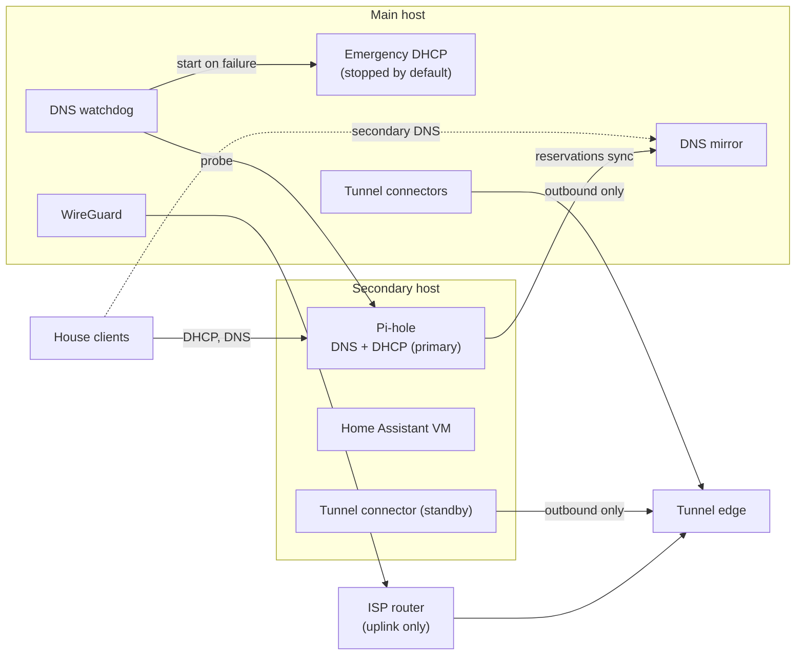

# Layer 2: Hosts and network

**What it is.** Two Linux hosts (Armbian/Ubuntu 24.04 on the ARM board, Ubuntu 26.04 on the x86 box) and the
network services the whole house relies on: DNS, DHCP, remote access and the tunnel edge.

**Depends on.** Layer 1, and the ISP router for the uplink.

**What depends on it.** Every container, the Home Assistant VM and every client in the house (they all get their
address and their DNS from here).

## Decisions

- **DHCP and DNS moved off the ISP router.** The router allowed 10 DHCP reservations; the house needs about 30.
  Pi-hole on the secondary host serves both, and pushes the reservations to a DNS mirror on the main host.
- **Automatic failover, proven by a real outage.** A watchdog on the main host probes the primary DNS. After 60 s
  without answers it starts an emergency DHCP server that is normally stopped. When the secondary host was
  shut down without warning, the watchdog went degraded at +57 s and DHCP was serving again 3 s later: 132 leases
  to 17 distinct clients, reservations honoured. Clients with an existing lease did not notice, because the
  primary already handed out the mirror as secondary DNS. The watchdog itself went through two review rounds
  that found real defects, for example announcing "emergency DHCP active" without checking that the container had
  actually started, and restarting the mirror on a single lost probe (it now needs consecutive failures).
- **No inbound ports for web services.** Remote access to web UIs goes through outbound-only tunnels with an
  identity provider in front. The main tunnel has a standby connector on the other host. Everything else goes
  through WireGuard.
- **SSH restricted to private address ranges at the firewall.** A forwarded port was collecting about 1,400
  password attempts per day. Password auth could not simply be turned off because the automation engine logs in
  with a password from the Docker network, so the restriction is by source range instead.
- **Global IPv6 off at the router, local IPv6 kept.** See [case study 2](../case-studies/02-stale-ipv6-prefix.md).
  A unique local prefix is still advertised by the DNS host because Matter devices need IPv6 on the LAN.
- **Hardware watchdogs on both hosts.** systemd feeds the SoC or chipset watchdog (30 s runtime timeout), so a hung
  kernel reboots on its own. On the x86 host the watchdog module was blacklisted by the distribution and had to be
  loaded explicitly; it is verified, not assumed.
- **Persistent journal.** The ARM distribution logs to a 47 MB RAM disk by default, which kept less than two hours
  of history. After an unexplained hang left no evidence, the journal moved to disk with a size cap.

## Traps learned

- **Docker started before its data disk.** The USB disk that holds all container data takes about 66 s to appear.
  Docker started at about 41 s and created empty directories under the not-yet-mounted mountpoint; 35 containers
  came up with apparently blank configuration. Nothing was lost, the real data was hidden underneath. Fix, in
  three layers: a longer device timeout in `fstab`, `RequiresMountsFor=` on the Docker unit, and an
  `ExecStartPre=mountpoint -q` guard so Docker refuses to start on the wrong filesystem. Failing to start is better
  than starting on an empty directory.
- **The same race, across hosts.** The media server on the main host mounts the library from the secondary host
  over SMB. If Docker came up before the share answered, the bind mount failed once and the restart policy did not
  retry; the service was down for 3.5 hours. A oneshot unit now waits for the share before the container starts.
- **NIC offload bug.** The Intel e1000e driver logged "transmit queue timed out, reset adapter" under load.
  TCP and generic segmentation offload (TSO/GSO) are disabled on that interface and the setting is persisted in NetworkManager.
- **Changing a bridge over SSH.** Any change to the host bridge is armed with a timed rollback
  (`systemd-run --on-active=240`) before it is applied.
- **Cloud integrations that never retry.** When the secondary host booted while its cable had a bad contact,
  Home Assistant's cloud integrations failed setup and stayed failed after the link came back, which silently
  broke the voice assistant. Boot without network is now a known failure mode to check after power events.
