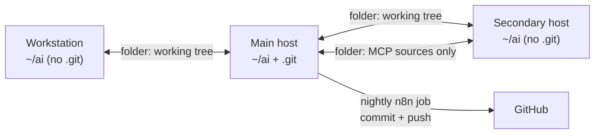

# Layer 3: Containers and sync

**What it is.** About 80 containers (51 on the main host and 29 on the secondary host at the time of writing),
managed with Docker Compose, one directory per stack. Plus a file-sync mesh that makes one working tree, `~/ai`,
identical on both servers and the workstation.

**Depends on.** Layer 2 (mounts, DNS, the tunnel edge).

**What depends on it.** n8n and the AI worker run here, and so do the media stack, feeds, cameras, the password
manager, the session archive and the voice servers.

## What runs where

| Main host (ARM64) | Secondary host (x86) |
|---|---|
| n8n, the AI worker container (runs agent jobs for n8n), upload service, web portal | AI console (web terminal used from the browser and the phone) |
| Tunnel connectors, WireGuard, DNS mirror, emergency DHCP | Pi-hole (primary DNS/DHCP), standby tunnel connector |
| Media server and its automation stack | Reverse proxy, feed reader, location history, inventory |
| Session archive ([cockpit](https://github.com/cascodigital/cockpit)), WhatsApp collector ([whatsapp-mcp-server](https://github.com/cascodigital/whatsapp-mcp-server)) | Camera restreamer, scrobbler, deals feed ([hardmob-monitor](https://github.com/cascodigital/hardmob-monitor)) |
| Nightly subtitle job ([subtitle-auto-translator](https://github.com/cascodigital/subtitle-auto-translator)) | Home Assistant runs here too, as a KVM VM rather than a container |

## The sync mesh

- **One tree, three places.** On the workstation it is a synced folder; inside the containers it is a bind mount
  of the same path; on the main host's shell it is a symlink to it. A skill, a script or a note edited anywhere is
  in effect everywhere within seconds.
- **Git lives on one machine only.** The sync tool does not carry `.git`. The main host is the only writer: a
  nightly n8n workflow commits and pushes each project repository. This removes the "two checkouts committed at
  once" class of problems. The publisher also writes the sync tool's temporary-file patterns into each repo's
  `.git/info/exclude`, because a project `.gitignore` does not cover them.
- **MCP sources have their own folder, shared only between the servers.** When MCP sources were added to the main
  folder, the workstation's stale index immediately resurrected servers that had been deleted months earlier.
  A separate folder, without the workstation, fixed it.
- **After editing on one side and running on the other, verify arrival** (compare a checksum on both sides)
  instead of waiting a fixed number of seconds.

## Decisions

- **The AI stack was split across hosts.** The interactive console used to run on the main host under a 2 GiB
  memory cap and was being OOM-killed with less than 900 MB free on the host. It moved to the x86 host (16 GB,
  6 GiB cap). Batch jobs stayed next to n8n on the main host.
- **Every container has an explicit memory limit.** A headless browser container was OOM-killed at 1 GB while
  attaching over CDP and now runs at 1.5 GB. The limits live only in the container, so the recreate command is
  documented next to the service.
- **Images that change their config schema are pinned.** A scrobbler update made a previously optional field
  mandatory. Without it, validation failed, yet the container stayed up with exit status 0 and ran only its
  cleanup task: no data, no alarm. The image is pinned and the watchdog checks the output (see
  [case study 1](../case-studies/01-up-but-crash-looping.md)).
- **Protected containers carry a label** (`keep=true`) so the monthly filtered prune never removes stopped-by-design
  job containers.

## Traps learned

- **PostgreSQL data directories are not portable between ARM64 and x86_64.** Moving a database between the hosts
  is `pg_dump` + `pg_restore`, never a copy of the data directory.
- **Some images ignore `PUID`/`PGID`.** A feed reader went into a restart loop until its cache directories had the
  permissions it expected.
- **A single-file bind mount and `sed -i` do not mix.** `sed -i` replaces the inode; the container keeps seeing the
  old file. Restart the container instead of reloading the service inside it.
- **Exited is not always broken.** Several containers are jobs that run and exit by design (subtitle translation,
  site sync browsers, emergency DHCP). Health reports list those under "stopped by design" before anything else,
  so that real anomalies stand out.
