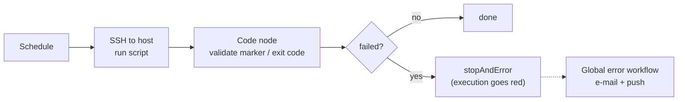

# Layer 4: Automation

**What it is.** Two engines with different jobs.

- **Home Assistant** (Home Assistant OS as a KVM VM on the secondary host) owns the house: devices, areas,
  automations, the voice pipeline, notifications to the phone. Node-RED and Zigbee2MQTT run as add-ons inside it.
- **n8n** (container on the main host, 65 active workflows) owns time and operations: every scheduled job, every
  watchdog, every alert, the nightly git publication and the agent jobs that run inside the AI worker.

**Depends on.** Layer 3 for n8n and the worker, Layer 2 for the VM, DNS and the tunnel edge.

**What depends on it.** Voice (Layer 5) runs on Home Assistant's pipeline. The AI layer (Layer 6) reads and writes
both engines through MCP servers and CLI wrappers. Every alert in the system ends up as a Home Assistant push
notification.

## The n8n job pattern

Every recurring job on the servers follows the same shape. New schedules go to n8n, never to a crontab, so that
there is one place to see what runs, when, and whether it failed.

- **The SSH node does not fail on a non-zero exit code.** It returns stdout and stderr and finishes as `success`.
  This was learned when a nightly job was down for three days while its watchdog stayed green. Scripts now print an
  explicit marker (`JOB_OK:...` / `JOB_FAIL:<reason>`), and the Code node also treats "no marker" and "no output"
  as failures. Silence is never read as success.
- **One global error workflow.** An audit found 56 active workflows with no error workflow configured (their
  failures reached nobody) and 12 SSH steps with no exit-code check. Now every workflow points to one error
  handler that sends e-mail and a phone push (through a local-only Home Assistant webhook), rate-limited to one
  alert per workflow every 6 hours.
- **The rule is enforced by a lint, not by memory.** A CLI audit checks every active workflow for the error
  workflow, a check after every SSH step, and that the published version is the one being edited. The expected
  result is zero findings; at the last run that was 65 active workflows, 51 SSH steps, 0 findings.
- **Jobs whose normal result is "nothing found" end with an explicit marker,** otherwise a broken job and a quiet
  day look the same.

## Decisions

- **Home Assistant as a VM, not a container.** Home Assistant OS keeps the add-on ecosystem and supervisor
  updates. Running it under KVM on the x86 host made it independent of the ARM board's memory pressure.
- **Writes to both engines go through APIs, never their databases.** A direct `UPDATE` on n8n's SQLite file once
  corrupted it. Workflow edits go through a CLI that sends only `{name, nodes, connections, settings}`, re-reads
  the result, compares it, republishes if needed and prints the rollback command.
- **Node-RED is edited through its Admin API with a dry run first.** The wrapper shows the patch, and only
  `--apply` deploys it.

## Traps learned

- **n8n's execution history has a global cap.** With no pruning variables set, n8n keeps 10,000 executions in
  total, not per workflow. A 2-minute job whose target was offline about 80% of the time produced 2,698 failed
  executions in 4.7 days and pushed the useful history of every other workflow from 14 days down to 4. Rule for
  any job running every 15 minutes or less: decide first what its normal failure state is, and exit cleanly in
  that state instead of throwing.
- **Retry on the alert node does not fix an alert path.** 26 e-mail alert nodes had no retry, and the day the
  SMTP relay failed the DNS had failed with it. The answer was a second, independent channel (push through Home
  Assistant by IP address), not more retries on the first.
- **Edge triggers miss states that exist at startup.** A Home Assistant trigger like `to: "on"` with `for:` never
  fires if the entity is already `on` when Home Assistant restarts. Watchdog automations get a periodic
  `time_pattern` sweep with a duration condition as a safety net.
- **Triggering an automation by hand tests its actions, not its trigger.** A watchdog is proven by waiting for
  the real condition and seeing `last_triggered` change on its own.
- **Changing a shared source means testing every consumer.** When a sensor used by several automations was
  replaced, one consumer that was edited but never exercised left an outdoor light on all night. Consumers are
  now listed before the change and each one is fired with a real trigger.
