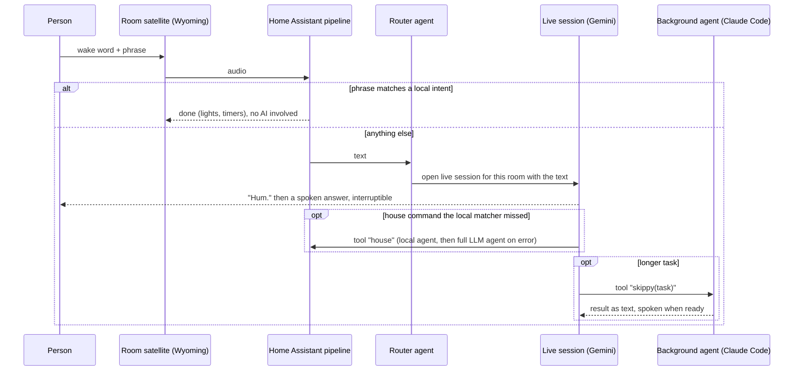

# Layer 5: Voice

**What it is.** Two rooms with an always-on voice satellite and a phone/watch client, all answering as the same
persona. The wake word is a custom openWakeWord model. Simple commands resolve locally in Home Assistant; anything
else becomes a real-time conversation with the Gemini Live API, which can hand longer tasks to a Claude Code agent
in the background.

**Depends on.** Layer 1 (speakerphones), Layer 4 (Home Assistant's Assist pipeline, the Wyoming protocol, the
openWakeWord add-on), Layer 3 (the AI console container that runs the background agent), and the tunnel edge for the
phone.

**What depends on it.** Daily use of the house. Voice transcripts are also written to the session archive, so the
AI layer's memory includes what was said by voice.

## Decisions

- **Local intents first.** "Turn on the light" never reaches a model. It resolves in the pipeline, instantly and
  offline.
- **Nobody decides "command or conversation".** Everything the local matcher does not take goes to a router agent
  whose prompt has a single rule: open the live session with the text. It cannot answer on its own. Measured by
  text: 4/4 phrases routed, including noise, in 1.8 to 3.2 s.
- **Same code in both rooms.** Only an environment file differs per room. Every change to the conversation daemon
  or its prompt goes to both hosts in the same task, and is confirmed by comparing checksums.
- **The heavy agent runs in the background.** The live model answers in under a second for direct questions
  (measured 0.6 to 0.9 s to first audio; about 5 s when it goes through the house tool). A task for the Claude agent
  runs asynchronously with a time limit and at most two at once. If the session closes before it finishes, the
  result is queued and delivered at the start of the next one.
- **Phone and watch use a native Android client** over a WebSocket bridge to the same live model, with the screen
  off, a Quick Settings tile and a watch tile. Session resumption keeps the topic across reconnects for 5 minutes;
  before that, a flaky mobile connection produced 15 fresh sessions in 45 minutes and lost the thread each time.
- **Language lock.** Transcription hints alone did not stop other languages from being transcribed and answered.
  The prompt treats speech in any language other than the two expected ones as noise and asks for a repeat. Proven
  with synthetic speech in a third language.
- **Context is budgeted.** The live model re-reads its context every turn and the input token rate is limited, so
  only recent memory sections and the last 24 h of voice transcripts are injected, not the full profile.

## Traps learned

- **A hung connect is silence, not an error.** One session in 50 over 14 days hung inside the live connect call with
  no error, no socket and no log. The satellite had already muted the pipeline voice, so the user heard nothing.
  The connect is now logged before it starts and bounded by a 12 s timeout that ends with a spoken error. The
  actual cause was found later: a stale IPv6 prefix (see
  [case study 2](../case-studies/02-stale-ipv6-prefix.md)).
- **Measured persona drift.** Transcripts showed an insult or nickname in 8 of 9 sessions, because "up to two per
  conversation" in the prompt becomes "every time" when sessions last three turns. Fixed by changing the prompt and
  re-measuring on transcripts, not by feel.
- **Docker bridges break multicast.** With about 37 Docker bridges on the main host, the satellite's zeroconf
  announcement hit the kernel's multicast group limit (`OSError 105`). The satellite runs with zeroconf off and is
  configured by address.
- **A satellite can be deaf with every health check green.** See [case study 4](../case-studies/04-deaf-satellite.md).
