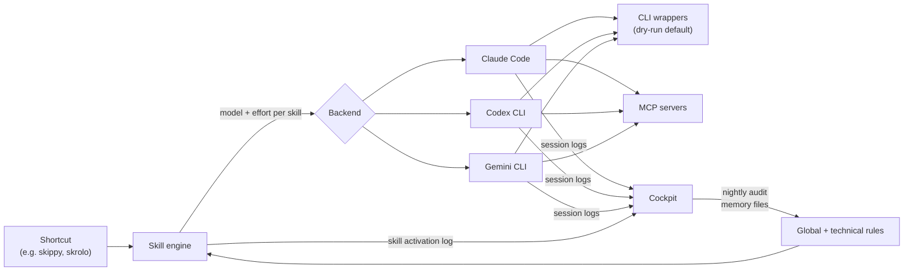

# Layer 6: AI operations

**What it is.** The layer where CLI coding agents (Claude Code, Codex CLI, Gemini CLI) operate the rest of the
system: they read state, change configuration, run jobs and answer questions. It has five parts.

| Part | What it does |
|---|---|
| Skill engine | One shell file (`invoke_with_skill`), identical in bash and zsh, that starts any of 26 domain skills on the chosen backend with the right model, effort level and injected rules. |
| Rules | A global rules file plus a technical rules file, injected into every skill that does technical work. The technical rules are the source of [engineering-principles.md](../engineering-principles.md). |
| CLI wrappers | Small commands for Home Assistant, Node-RED, n8n and DNS/DHCP. Reads are direct; writes are dry-run unless `--apply`. Agents are told to use these before MCP tools or raw API calls. |
| MCP servers | Servers for Home Assistant, Node-RED, n8n, WhatsApp ([whatsapp-mcp-server](https://github.com/cascodigital/whatsapp-mcp-server)), YouTube Music and others, built automatically per host architecture. |
| Memory | [cockpit](https://github.com/cascodigital/cockpit) collects every session from every machine, indexes it, writes a nightly audit and distills memory files that the next session loads. |

**Depends on.** Every layer below. The agents run in two containers: the console on the secondary host
(interactive, used from a browser or the phone) and the worker on the main host (non-interactive jobs triggered by
n8n, such as voice tasks, the nightly git sync and dashboard builds).

**What depends on it.** The voice layer's background tasks, several n8n jobs, and day-to-day operation of the house
and servers.

## Decisions

- **One skill engine, one source.** The dispatcher used to be copied into three shell rc files, and the copies had
  drifted: one offered a menu option whose binary did not exist (exit 127), and the activation log was implemented
  two different ways. It is now one file, written to run unchanged in bash and zsh, and a `skcheck` command
  verifies that every skill has a shortcut and that the engine was loaded from the single source.
- **Skills are plain folders.** Each skill is a `SKILL.md` with its references and scripts, in the synced tree, so
  the same skill is available to every backend on every machine.
- **Deterministic gates around the model.** Where a model's claim can be checked, a script checks it. The music
  curator ([rolo](https://github.com/cascodigital/rolo)) validates every track against the listening history before
  and after a playlist is created; [kitchen-cast](https://github.com/cascodigital/kitchen-cast) accepts an AI
  playlist only after that independent delivery check passes.
- **CLI wrappers before MCP.** Wrappers are cheaper in context, scriptable, and carry the safety behaviour:
  backup, write, re-read, validate, and print the rollback. The DNS reservation wrapper runs the DNS server's own
  config test after writing and restores the backup by itself if the test fails.
- **MCP servers build themselves, with rollback.** MCP sources sync between the two servers. An hourly job on each
  host rebuilds a server's environment when its manifest, the host architecture or the runtime version changes.
  The old environment is kept until the new one connects; if it does not, the old one comes back. This was tested
  with a deliberately missing dependency: both hosts reported the build failure and the server stayed connected.
- **Broad access, narrow confirmation.** Agents have a full shell on the hosts by design. What requires
  confirmation is the action: edge devices (a camera, a lamp, a satellite) may be restarted directly; Home Assistant
  core, a host, Docker or a central service only after a warning and an explicit yes. Hot reloads are preferred over
  restarts.

## Traps learned

- **Unpinned SDK majors break servers silently.** `pip install mcp` started pulling 2.x, which removed an API
  servers written for 1.x import. The upper bound `mcp<2` now lives in each server's own manifest.
- **Environment drift between where an agent runs.** The same agent can run in a container on one host or bare
  metal on the laptop, and each leaves the network with a different source address. An SSH key restricted by source
  address was once diagnosed as "broken" because the agent assumed where it was running. The first step of any
  network task is now to measure the environment (`hostname`, `/.dockerenv`, `$SSH_CLIENT`), not assume it.
- **Long scripts get pasted, not read.** Safety therefore has to be structural: audit and action never in the same
  script, state-changing scripts short and dry-run by default, the gate variable initialised to false on its own
  line, and the part that needs reading printed last, right next to the action.
- **Memory needs a contradiction rule.** The long-term memory file changes only when new evidence contradicts it,
  and its size limit is enforced by code; a rolling 30-day file holds the rest.
